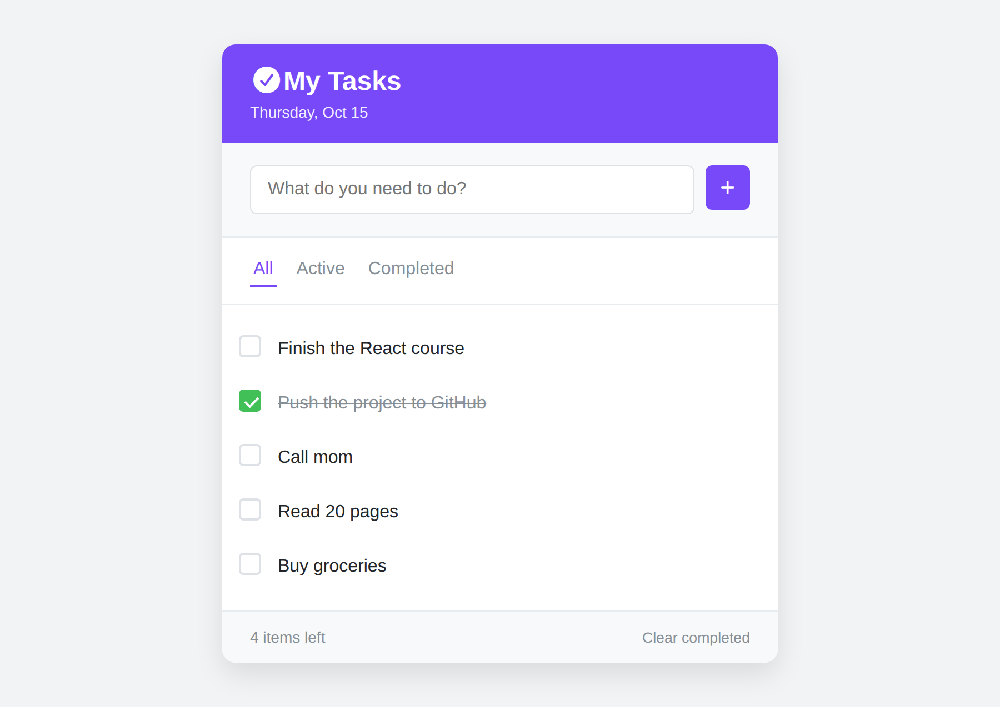

# Todo App

A simple todo app built with React.



## Features

- Add a task
- Mark a task as done
- Delete a task
- Filter tasks: All, Active, Completed
- See how many tasks are left
- Clear all completed tasks
- Tasks are saved in the browser with localStorage

## Tech

- React
- Vite

## Run locally

```
npm install
npm run dev
```

## Build

```
npm run build
```
